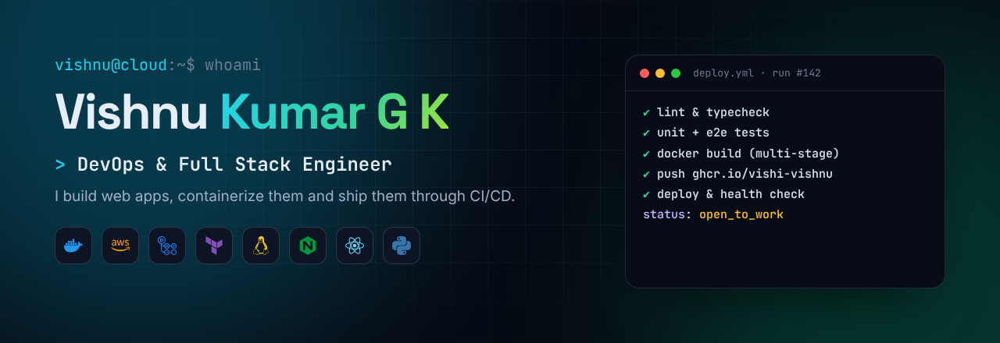
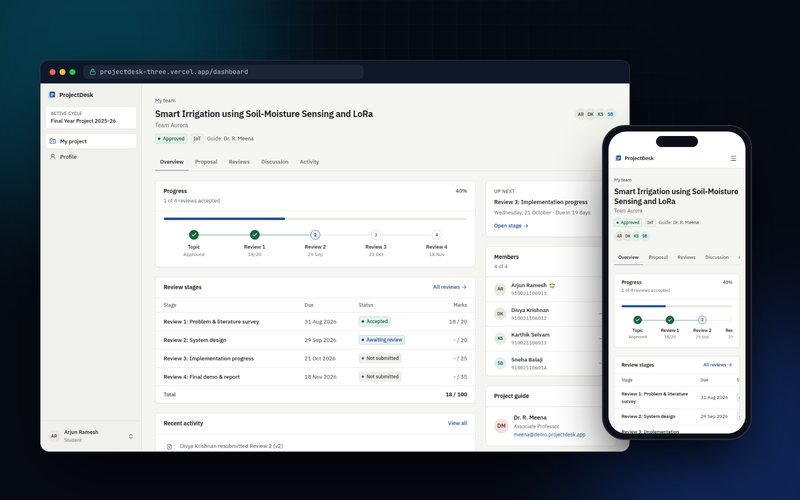
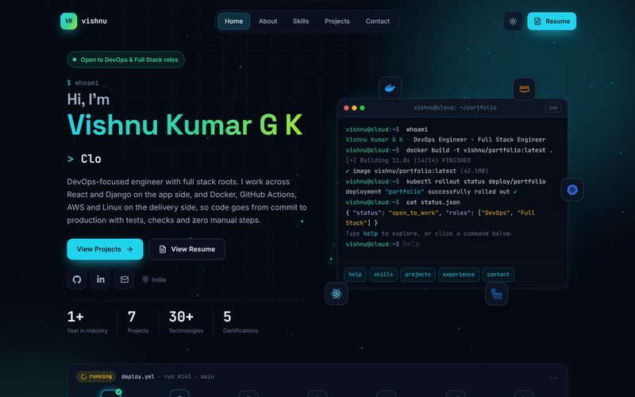
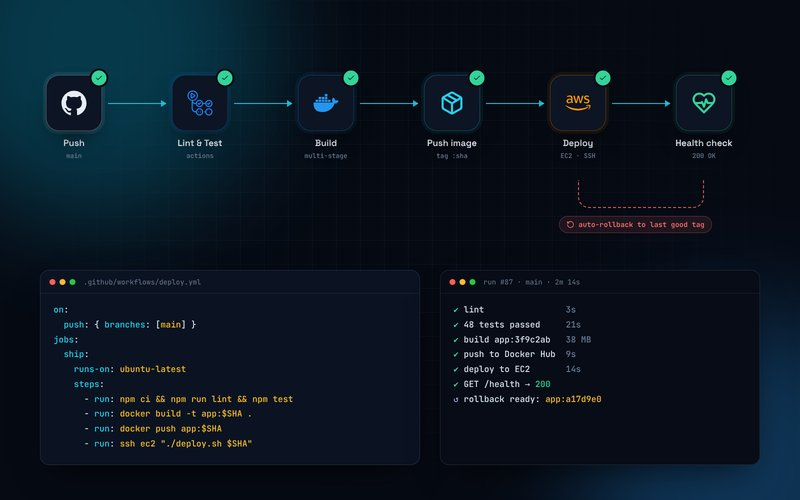
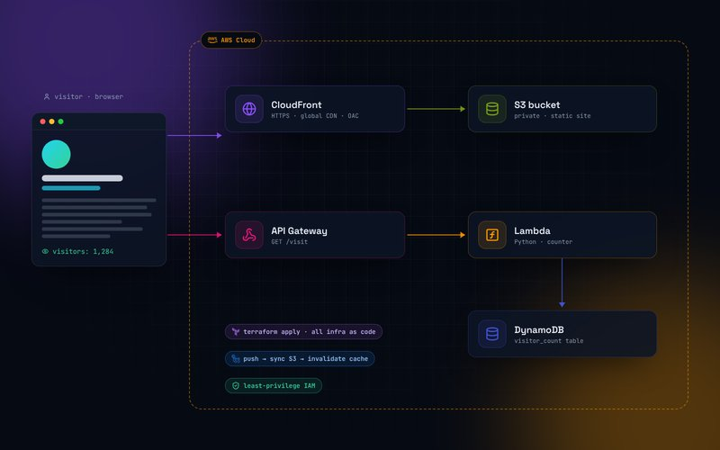

<div align="center">



### DevOps & Full Stack Engineer · I build web apps, containerize them and ship them through CI/CD

[](https://github.com/vishi-vishnu/portfolio)
[](https://www.linkedin.com/in/vishnu081/)
[](mailto:vishi08vishnu@gmail.com)

</div>

---

## About me

```yaml
name: Vishnu Kumar G K
role: [DevOps Engineer, Full Stack Engineer]
current: Full Stack Engineer @ Inthera Consulting Group
building: Inflow, a multi-tenant SaaS platform (React + TypeScript + Django REST Framework)
focus: [Docker, GitHub Actions CI/CD, AWS, Linux]
learning: [AWS, Kubernetes, Terraform]
education: B.E. Electronics and Communication Engineering, K.L.N College of Engineering
status: open_to_work   # DevOps, Cloud and Full Stack roles
```

- Containerise apps with **multi-stage Docker builds** and Docker Compose (Django, PostgreSQL, Redis)
- Write **GitHub Actions pipelines** that lint, test, scan, build images, push to GHCR and deploy
- Build **React + TypeScript** frontends and **Django REST** APIs with JWT, RBAC, API-key scopes and Redis rate limiting

## Tech stack

**Cloud & DevOps**


**Frontend**


**Backend & data**


**Tools**


<br/>


## Featured projects

<table>
  <tr>
    <td width="50%" valign="top">
      <a href="https://github.com/vishi-vishnu/projectdesk"></a>
      <h3><a href="https://github.com/vishi-vishnu/projectdesk">ProjectDesk</a></h3>
      Final-year project management platform for students, guides and coordinators. CI/CD with lint, unit, Playwright E2E and CodeQL, Docker image on GHCR, Kubernetes rollout test on kind and Terraform.
      <br/><br/>
      <a href="https://projectdesk-three.vercel.app">Live demo</a> · <code>React</code> <code>TypeScript</code> <code>Firebase</code> <code>Docker</code> <code>Kubernetes</code>
    </td>
    <td width="50%" valign="top">
      <a href="https://github.com/vishi-vishnu/portfolio"></a>
      <h3><a href="https://github.com/vishi-vishnu/portfolio">Portfolio</a></h3>
      My DevOps-themed portfolio with an interactive terminal, built like a production app: typed, tested, containerised with a multi-stage Dockerfile and shipped through GitHub Actions.
      <br/><br/>
      <code>React</code> <code>TypeScript</code> <code>Vite</code> <code>Docker</code> <code>Nginx</code> <code>GitHub Actions</code>
    </td>
  </tr>
  <tr>
    <td width="50%" valign="top">
      
      <h3>Dockerized CI/CD Pipeline <sub>(in progress)</sub></h3>
      Push to main: lint, test, multi-stage Docker build, push to Docker Hub tagged with the commit SHA, deploy to AWS EC2 with a health check and automatic rollback.
      <br/><br/>
      <code>Docker</code> <code>GitHub Actions</code> <code>AWS EC2</code> <code>Nginx</code>
    </td>
    <td width="50%" valign="top">
      
      <h3>Cloud Resume on AWS <sub>(planned)</sub></h3>
      Serverless resume: S3 + CloudFront with OAC, visitor counter on API Gateway, Lambda and DynamoDB. All infrastructure in Terraform, deployed by GitHub Actions.
      <br/><br/>
      <code>AWS</code> <code>Terraform</code> <code>Lambda</code> <code>DynamoDB</code>
    </td>
  </tr>
</table>

**Frontend work**

| Project | Stack | Links |
| --- | --- | --- |
| [TravelX Landing Page](https://github.com/vishi-vishnu/Travel-Landing-Page) | HTML, CSS, JavaScript, GSAP | [Live](https://vishi-vishnu.github.io/Travel-Landing-Page/) |
| [Digital Agency Website](https://github.com/vishi-vishnu/Digital-Agency) | HTML, CSS, Bootstrap | [Live](https://vishi-vishnu.github.io/Digital-Agency/) |
| [Responsive Shoe Store](https://github.com/vishi-vishnu/Responsive-shoes-store) | HTML, CSS, AOS | [Live](https://vishi-vishnu.github.io/Responsive-shoes-store/) |

## Certifications

`Discover DevOps (Microsoft)` `AWS Cloud Practitioner Essentials (AWS)` `Programming with JavaScript (Meta)` `React.js Basics (Meta)` `Web Development (ICT Academy)`

## Contribution graph

<picture>
  <source media="(prefers-color-scheme: dark)" srcset="https://raw.githubusercontent.com/vishi-vishnu/vishi-vishnu/output/github-snake-dark.svg" />
  
</picture>

<sub>Generated daily by a GitHub Actions workflow in this repo.</sub>
