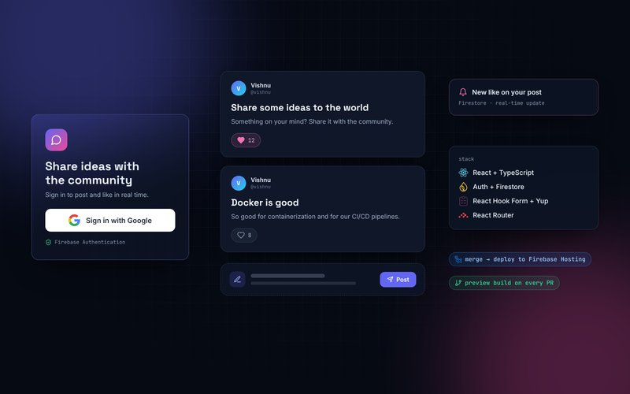
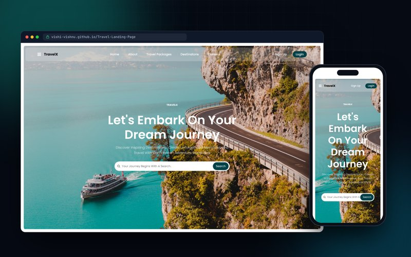

<div align="center">


<a href="https://vishnukumar-gk.vercel.app">
  
</a>

<br/>

<a href="https://vishnukumar-gk.vercel.app"></a>
<a href="https://www.linkedin.com/in/vishnu081/"></a>
<a href="mailto:vishi08vishnu@gmail.com"></a>
<a href="https://vishnukumar-gk.vercel.app/Vishnu_Kumar_GK_Resume.pdf"></a>

</div>

<br/>

## About me

<table>
<tr>
<td width="55%" valign="top">

I'm an Electronics and Communication engineer who moved into software. For the last year I've been building and shipping **Inflow**, a multi-tenant SaaS platform at **Inthera Consulting Group**: React and TypeScript screens, Django REST APIs, Redis-backed rate limiting, and the Docker Compose setup that runs it all.

Now I'm going deeper into **DevOps**: AWS cloud services, containers with Docker, and automation with Linux and shell scripting. I care about systems that are not just powerful, but **reliable, scalable and production-ready**.

> **My goal:** use both AI and cloud technologies to build innovative solutions that make a real impact.

</td>
<td width="45%" valign="top">

```yaml
name: Vishnu Kumar G K
role:
  - DevOps Engineer
  - Full Stack Engineer
current: Full Stack Engineer @ Inthera
focus: [Docker, CI/CD, AWS, Linux]
learning: [Kubernetes, Terraform, AWS]
education: B.E. ECE, K.L.N College
location: India
status: open_to_work
```

</td>
</tr>
</table>

## Tech stack

| Area | Tools |
| --- | --- |
| **Cloud & DevOps** |  |
| **Frontend** |  |
| **Backend & data** |  |
| **Tools** |  |
| **Workflow** |      |

## Featured projects

<table>
<tr>
<td width="50%" valign="top">
<a href="https://github.com/vishi-vishnu/projectdesk"></a>

### [ProjectDesk](https://github.com/vishi-vishnu/projectdesk)
Final-year project platform for students, guides and coordinators. Full CI/CD: lint, unit and Playwright E2E tests, CodeQL, Docker image on GHCR, Kubernetes rollout test on kind and Terraform.

`React` `TypeScript` `Firebase` `Docker` `Kubernetes` `Terraform`
<br/>[**Live demo**](https://projectdesk-three.vercel.app) · [Code](https://github.com/vishi-vishnu/projectdesk)
</td>
<td width="50%" valign="top">
<a href="https://github.com/vishi-vishnu/portfolio"></a>

### [Portfolio](https://github.com/vishi-vishnu/portfolio)
My DevOps-themed portfolio with an interactive terminal. Built like a production app: typed, tested, containerised with a multi-stage Dockerfile and shipped through GitHub Actions to Vercel.

`React` `TypeScript` `Vite` `Docker` `Nginx` `GitHub Actions`
<br/>[**Live site**](https://vishnukumar-gk.vercel.app) · [Code](https://github.com/vishi-vishnu/portfolio)
</td>
</tr>
<tr>
<td width="50%" valign="top">
<a href="https://github.com/vishi-vishnu/react-course/tree/Firebase-Social-Media-project"></a>

### [Social Media Web App](https://github.com/vishi-vishnu/react-course/tree/Firebase-Social-Media-project)
Real-time posts and likes with Google sign-in. Firebase Auth and Firestore, forms validated with React Hook Form and Yup, and GitHub Actions deploying to Firebase Hosting with PR previews.

`React` `TypeScript` `Firebase` `React Router` `GitHub Actions`
<br/>[Code](https://github.com/vishi-vishnu/react-course/tree/Firebase-Social-Media-project)
</td>
<td width="50%" valign="top">
<a href="https://github.com/vishi-vishnu/Travel-Landing-Page"></a>

### [TravelX Landing Page](https://github.com/vishi-vishnu/Travel-Landing-Page)
Fully responsive travel landing page with GSAP ScrollTrigger animations and a mobile slide-in menu.

`HTML` `CSS` `JavaScript` `GSAP`
<br/>[**Live demo**](https://vishi-vishnu.github.io/Travel-Landing-Page/) · [Code](https://github.com/vishi-vishnu/Travel-Landing-Page)
</td>
</tr>
</table>

**More frontend work:** [Digital Agency Website](https://github.com/vishi-vishnu/Digital-Agency) ([live](https://vishi-vishnu.github.io/Digital-Agency/)) · [Responsive Shoe Store](https://github.com/vishi-vishnu/Responsive-shoes-store) ([live](https://vishi-vishnu.github.io/Responsive-shoes-store/))

### Building next

| Project | What it does | Stack |
| --- | --- | --- |
| **Dockerized CI/CD Pipeline** | Push to main: lint, test, multi-stage Docker build, push to Docker Hub tagged with the commit SHA, deploy to AWS EC2 with a health check and automatic rollback | Docker, GitHub Actions, AWS EC2, Nginx |
| **Cloud Resume on AWS** | Serverless resume on S3 + CloudFront, visitor counter on API Gateway, Lambda and DynamoDB, all in Terraform | AWS, Terraform, Lambda, DynamoDB |

## Experience

| Role | Company | When |
| --- | --- | --- |
| **Full Stack Engineer** | Inthera Consulting Group | Jan 2026 - Present |
| **DevOps Intern** | Inthera Consulting Group | Oct 2025 - Dec 2025 |
| **B.E. Electronics & Communication** | K.L.N College of Engineering | 2021 - 2025 |

<details>
<summary><b>What I've worked on at Inthera</b></summary>
<br/>

- Built features for **Inflow**, a multi-tenant SaaS for projects, tasks, tickets and time tracking (React + TypeScript, Django REST Framework)
- Hashed **API-key auth with scopes** and **plan-based rate limiting** (30 / 150 / 300 requests per minute) with Redis-backed DRF throttling
- Centralised role checks into a permission catalogue with **JWT sessions and RBAC**
- **React.lazy code splitting** across 14 routes, about 800 KB off the first load
- Containerised the dev stack (Django, PostgreSQL, Redis) with **Docker Compose**: migrations, health checks, environment config
- Shipped changes through a **GitHub Actions CI/CD** pipeline; tested APIs with Postman and automated tests

</details>

## Certifications


## Contributions

<picture>
  <source media="(prefers-color-scheme: dark)" srcset="https://raw.githubusercontent.com/vishi-vishnu/vishi-vishnu/output/github-snake-dark.svg" />
  
</picture>

---

<div align="center">

**Open to DevOps, Cloud and Full Stack roles.** Let's talk: [vishi08vishnu@gmail.com](mailto:vishi08vishnu@gmail.com) · [LinkedIn](https://www.linkedin.com/in/vishnu081/) · [Portfolio](https://vishnukumar-gk.vercel.app)

</div>
